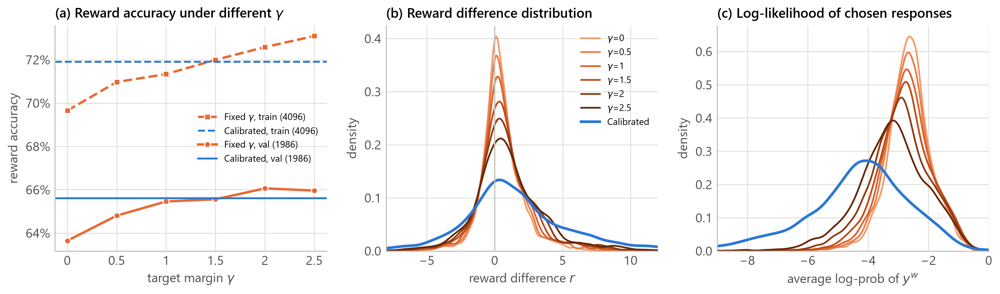
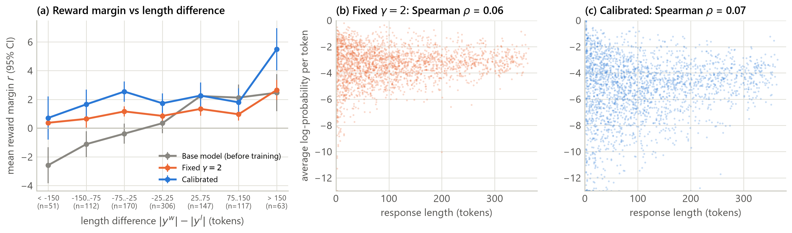
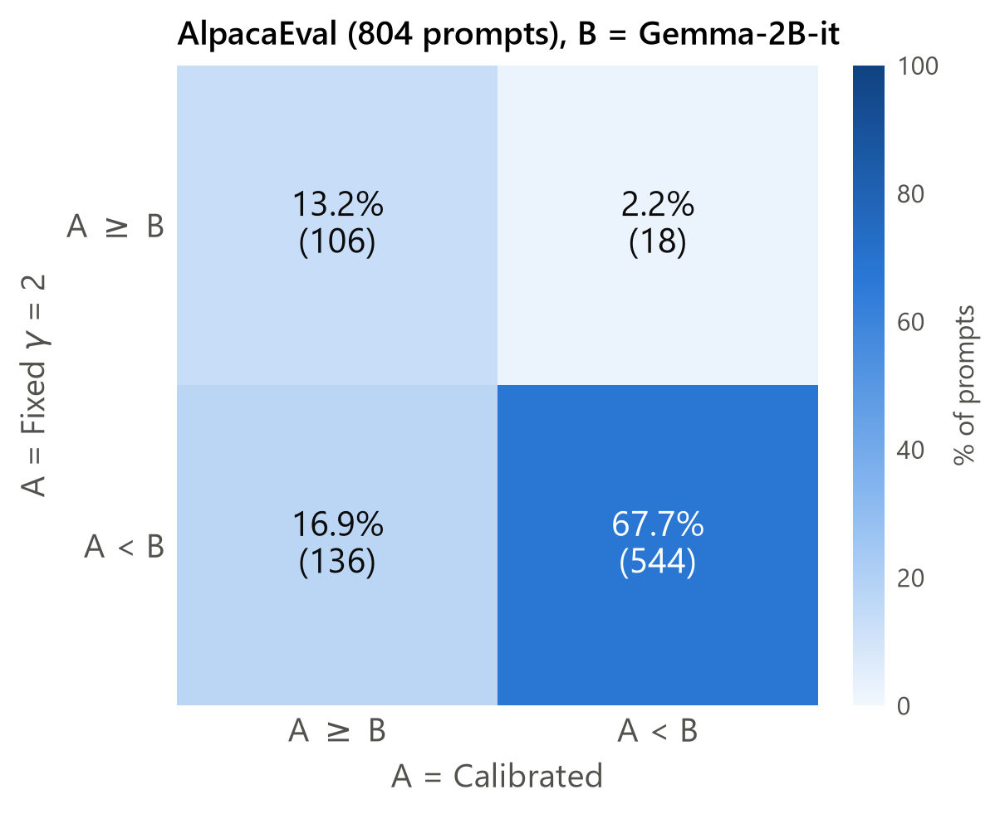
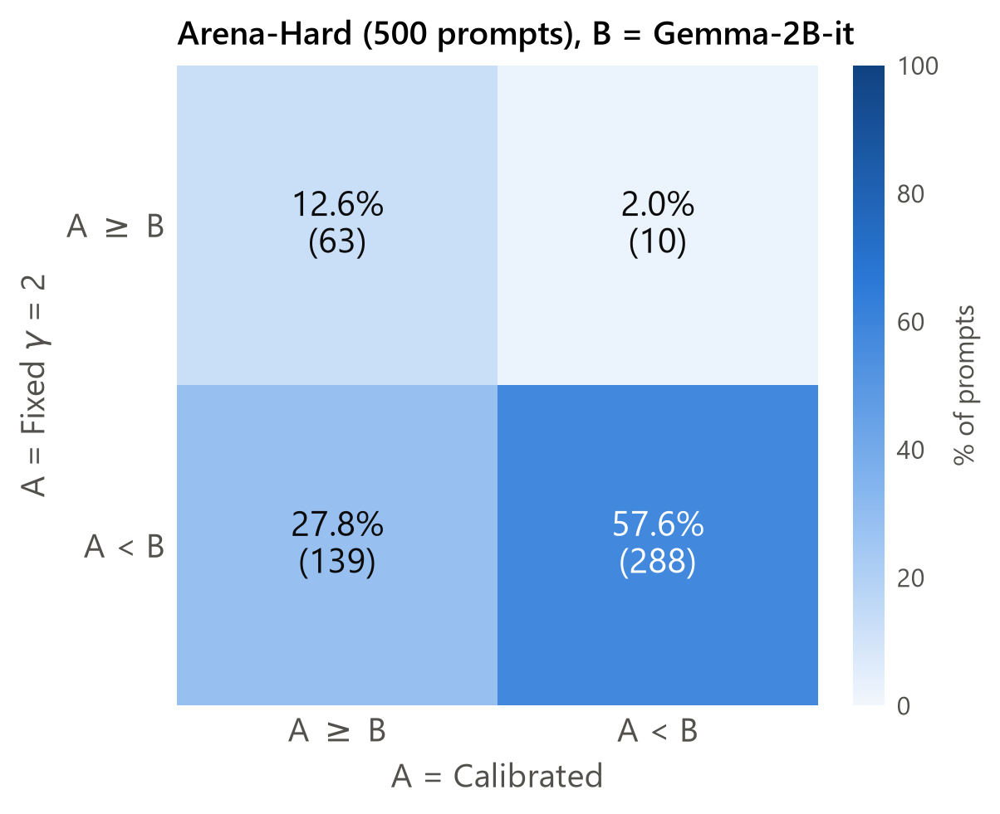

# AdaptiveSimPO

SimPO (Meng et al., 2024) trains a policy to rank preferred responses above rejected ones with a single fixed target reward margin γ. The best γ varies across models and datasets, so it is usually chosen by grid search, which costs one full training run per candidate value and requires held-out data for model selection. We propose a **calibrated margin** $\gamma_i=(1-\hat k)\,r_i$, obtained by reading the SimPO loss as the negative log-likelihood of a Bradley–Terry model whose log-odds are proportional to the reward gap, $\log\frac{p_i}{1-p_i}=k\,r_i$. Under a normal approximation to the reward gaps the slope has the closed form $k=2\mu/\sigma^2$, which we estimate from every batch. The margin therefore has no free magnitude to tune, and a single training run replaces both the γ grid and the selection step. On Qwen3-0.6B fine-tuned with LoRA on 4,096 UltraFeedback pairs, the untuned calibrated margin matches the best fixed margin from γ ∈ {0, 0.5, 1, 1.5, 2, 2.5}, chosen with hindsight on the 1,986 test pairs, in held-out preference accuracy (65.6% vs. 66.1%, exact McNemar p = 0.53) and reaches win rates of 82.3% on the full AlpacaEval set (804 prompts) and 88.0% on the full Arena-Hard v0.1 set (500 prompts) against it in pairwise generation comparisons judged by GPT-6.2-Sol (ties count as half; length-controlled 82.8% and 87.3%). Against the public answers of Gemma-2B-it, which both 0.6B policies lose to, the calibrated policy wins 26.7% (AlpacaEval) and 34.9% (Arena-Hard) of the prompts, against 13.3% and 12.6% for the fixed margin.

## Setup

On a machine without the local folders, download [Qwen/Qwen3-0.6B](https://huggingface.co/Qwen/Qwen3-0.6B) to `models/Qwen3-0.6B`, the two UltraFeedback-binarized Parquet files to `data/ultrafeedback_binarized/`, then create the environment and the data subsets (Windows, Python 3.14, NVIDIA GPU with CUDA 13):

```powershell
py -3.14 -m venv .venv
.\.venv\Scripts\python.exe -m pip install "torch==2.12.1+cu130" --index-url https://download.pytorch.org/whl/cu130
.\.venv\Scripts\python.exe -m pip install -r requirements.txt
.\.venv\Scripts\python.exe prepare_data.py
```

## Usage

```powershell
# Tests (formula checks + CPU pipeline smoke test)
.\.venv\Scripts\python.exe -m unittest discover -s tests -t . -v

# Full experiment: train fixed γ ∈ {0, 1, 2} and calibrated -> dev selection -> test scoring -> generate -> judge -> results.md
.\run_experiment.ps1 -WhatIf
.\run_experiment.ps1

# Evaluate an existing run (pass the variants it contains)
.\run_experiment.ps1 -RunDir outputs\run-bs16-lr0.0001-ep1-seed42-C -EvalOnly -Variants "fixed:0","fixed:1","fixed:2","calibrated"

# GPT judge on the cached generations of a run
.\.venv\Scripts\python.exe research\llm_judge.py outputs\<run>\generations-ae128-seed42-g16 --variant calibrated --baseline fixed-g2 --model gpt-6.2-sol --effort medium
```

Variant specs are `fixed:<γ>` and `calibrated`. With `-SkipEval` no fixed variant is required. With `-EvalOnly` the adapter list is built from `-Variants`, so pass the variants the run directory contains. `-GenerateVariants` restricts generation to the listed non-fixed variants (the dev-selected baseline is always generated), and `-GenerateGroup` (default 16) sets how many prompts share one sampling seed. `-BatchSize`, `-LearningRate` and `-Epochs` set the optimisation budget (defaults 16, 1e-4 and 1) and the run directory name records them; `-TrainData`, `-DevData` and `-TestData` replace the data files. Re-running with an existing `-RunDir` trains only the missing variants and reuses cached generations. `research/merge_runs.py` combines run directories for one evaluation; `--adapters` keeps only the listed adapters, and a run given as `PATH=SUFFIX` has SUFFIX appended to its adapter names. The individual scripts can be run directly; see `--help` on each, for example:

```powershell
.\.venv\Scripts\python.exe train.py --margin calibrated --output outputs\custom\calibrated
```

Custom data is UTF-8 JSONL with one pair per line: `{"prompt": "...", "chosen": "...", "rejected": "..."}`, optionally with `score_chosen` and `score_rejected`. A string prompt is wrapped as a user message in the chat template; a message list is used as is.

## Method

### SimPO reward gap and loss

For prompt $x_i$, winning (chosen) answer $y_i^w$ and losing (rejected) answer $y_i^l$, SimPO uses the length-normalised log-likelihood of the policy $\pi_\theta$ as an implicit reward:

$$
\frac{\beta}{|y|}\log\pi_\theta(y\mid x)=\frac{\beta}{|y|}\sum_{k=1}^{|y|}\log\pi_\theta(y_k\mid x,y_{\lt k}),
$$

where $|y|$ is the number of answer tokens. The reward gap of pair $i$ is

$$
r_i=\frac{\beta}{|y_i^w|}\log\pi_\theta(y_i^w\mid x_i)-\frac{\beta}{|y_i^l|}\log\pi_\theta(y_i^l\mid x_i).
$$

$r_i>0$ means the pair is ranked correctly and $r_i<0$ means it is misranked. With a target margin $\gamma_i$, the per-pair SimPO loss is

$$
L_i=-\log\sigma(r_i-\gamma_i)=\mathrm{softplus}(\gamma_i-r_i),\qquad
\sigma(a)=\frac{1}{1+e^{-a}},\quad \mathrm{softplus}(a)=\log\left(1+e^{a}\right),
$$

and the training objective is the batch mean of $L_i$. SimPO uses one constant $\gamma_i=\gamma$ for all pairs, tuned per setting.

$\gamma_i$ is detached after it is computed, so

$$
\frac{\partial L_i}{\partial r_i}=-\sigma(\gamma_i-r_i)=-\frac{1}{1+e^{\,r_i-\gamma_i}}.
$$

At the same $r_i$, a larger $\gamma_i$ puts more gradient weight on raising that pair's reward gap. A pair with $\gamma_i=0$ still trains.

### Calibrated margins: the SimPO loss as a negative log-likelihood

The SimPO loss $-\log\sigma(r_i-\gamma_i)$ has the form of a negative log-likelihood, so minimising it maximises the likelihood of the observed labels under some Bradley–Terry model. With $\gamma_i=0$ that model takes the reward gap itself as the log-odds that $y_i^w$ is preferred. But $r$ is a score, not a calibrated log-odds: $r=3$ does not mean that the label agrees with the ranking with probability $\sigma(3)=95\%$. The calibrated margin instead lets the log-odds be *proportional* to the gap, estimates the constant from the data, and picks $\gamma_i$ so that the SimPO loss is exactly the negative log-likelihood of that model.

#### Motivation: minimising the SimPO loss maximises a likelihood

**A Bradley–Terry model with a temperature.** Assume that the label prefers $y_i^w$ over $y_i^l$ with probability

$$
p_i=\sigma(k\,r_i),\qquad\text{i.e.}\qquad \log\frac{p_i}{1-p_i}=k\,r_i ,
$$

so the log-odds are proportional to the reward gap. $k>0$ is an inverse temperature: it says how many log-odds one unit of reward gap is worth. The likelihood of the labels of a batch $B$ and its negative logarithm are

$$
\mathcal L_B(\theta)=\prod_{i\in B}p_i,\qquad
-\log\mathcal L_B(\theta)=-\sum_{i\in B}\log\sigma(k\,r_i).
$$

$k=1$ gives back the SimPO loss with zero margin.

**Matching the SimPO loss.** The SimPO loss of each pair equals its term of this negative log-likelihood when

$$
-\log\sigma(r_i-\gamma_i)=-\log\sigma(k\,r_i)
\quad\Longleftrightarrow\quad
\gamma_i=(1-k)\,r_i .
$$

With this margin, minimising the SimPO loss is maximising the likelihood of the labels under the calibrated model.

**The gradient.** $k$ is estimated from the current batch as $\hat k$ (see "Estimating $k$" below) and held fixed within the step. Then

$$
\nabla_\theta\big(-\log\mathcal L_B\big)=-\hat k\sum_{i\in B}\sigma(-\hat k\,r_i)\,\nabla_\theta r_i .
$$

The SimPO loss with the detached margin $\gamma_i=(1-\hat k)\,r_i$ has gradient $-\sum_i\sigma(\gamma_i-r_i)\,\nabla_\theta r_i$ (from $\partial L_i/\partial r_i$ above), and $\sigma(\gamma_i-r_i)=\sigma(-\hat k\,r_i)$. Both therefore give every pair the same weight

$$
w_i=-\frac{\partial L_i}{\partial r_i}=\sigma(\gamma_i-r_i)=\sigma(-\hat k\,r_i),
$$

and differ only by the common factor $\hat k$: the forward losses are equal, and because the margin is detached, back-propagation leaves the factor out. The SimPO step with the calibrated margin thus points along the gradient of the calibrated log-likelihood, with a raw size that differs by $1/\hat k$ at the same learning rate.

This weight is the only way a detached margin acts on training. Conversely, every weight $w\in(0,1)$ is produced by the margin $\gamma_i=r_i+\mathrm{logit}\,w$, so a margin rule is a rule for sharing the gradient among pairs; since Adam normalises the overall scale of the update, mainly the relative weights matter (training logs the share of $\sum_iw_i$ on misranked pairs as `weight_share_misranked`). Three properties of the calibrated weight follow:

- *It is the surprise of the observed outcome* under the calibrated model: a correctly ranked pair gets $1-\sigma(\hat k|r_i|)$ and a misranked pair gets $\sigma(\hat k|r_i|)$. The zero margin uses $\sigma(-r_i)$ instead, which treats $r_i$ itself as log-odds.
- *It changes the temperature of the weights.* For a margin rule $\gamma=g(r)$, $\partial w/\partial r=(g'-1)\,w(1-w)$, so the logit of the weight has slope $g'-1$ in $r$. A fixed γ ($g'=0$) keeps the slope $-1$ and only shifts the sigmoid; the calibrated margin ($g'=1-\hat k$) has slope $-\hat k$, which for $0<\hat k<1$ flattens the weight profile.
- *It needs margins of both signs.* With $\gamma_i=0$ a misranked pair already has $w_i>1/2$, so lowering its weight requires a negative margin. For $0<\hat k<1$ the calibrated margin is positive for correctly ranked pairs and negative for misranked ones.

#### Estimating $k$

Assume that the reward gaps of the current pairs are normal, $r\sim\mathcal N(\mu,\sigma^2)$, with density

$$
p(a)\propto\exp\!\left[-\frac{(a-\mu)^2}{2\sigma^2}\right].
$$

Every pair is oriented by its label, so among the pairs whose gap has magnitude $a>0$, those with $r=a$ agree with their label and those with $r=-a$ disagree. The log-odds of agreement at $|r|=a$ are therefore the log density ratio, and the model requires them to equal $ka$:

$$
k\,a=\log\frac{p(a)}{p(-a)}=\frac{(a+\mu)^2-(a-\mu)^2}{2\sigma^2}=\frac{4\mu a}{2\sigma^2}=\frac{2\mu}{\sigma^2}\,a,
\qquad\text{so}\qquad k=\frac{2\mu}{\sigma^2}.
$$

For normal gaps the logistic model is thus exact, and $2\mu/\sigma^2$ is also the value of $k$ that maximises the likelihood. The implementation uses $\hat k=2\bar r_B/s_B^2$, computed from the $B=16$ gaps of the current batch (population variance), with a lower bound of 0.01: a batch with a nonpositive mean gap carries no evidence that the scores are informative, and $\hat k=0.01$ then gives every pair a weight close to 1/2. In training, 32 of the 256 steps (12.5%; 21 of them in the first half) hit this bound, while the largest estimate was 2.05.

- *Real gaps.* Real gaps are not normal (see Limitations), so on real data $2\mu/\sigma^2$ is an approximation. Heavy tails inflate the variance and pull $2\bar r/s^2$ down, which flattens the weights.
- *Small batches.* With 16 gaps the estimate is noisy: in the experiment it ranged from 0.02 to 0.77 over the first 8 steps, and averaged 0.23 over training.

The rule needs no search over a margin magnitude; the lower bound is an implementation choice.

#### What happens to each kind of pair

The table crosses the sign of $r$ with its size and compares three rules at the same gap. Every rule column is the per-pair gradient weight $w=\sigma(\gamma-r)$ of that rule, i.e. how strongly the pair is pushed:

- *Zero margin*: $\gamma=0$, weight $\sigma(-r)$;
- *Fixed γ = 1*: SimPO with a constant margin, weight $\sigma(1-r)$;
- *Calibrated, $\hat k=0.5$*: the calibrated margin at a slope typical of a trained model, weight $\sigma(-0.5\,r)$;
- *Calibrated margin*: the margin $\gamma=(1-\hat k)\,r$ itself at $\hat k=0.5$, in reward units (for comparison, the fixed rule's margin is 1 for every pair).

| Pair | $r$ | Zero margin: weight $\sigma(-r)$ | Fixed γ = 1: weight $\sigma(1-r)$ | Calibrated, $\hat k=0.5$: weight $\sigma(-0.5\,r)$ | Calibrated margin $(1-\hat k)\,r$, $\hat k=0.5$ | What happens |
|---|---:|---:|---:|---:|---:|---|
| confidently correct | +5 | 0.007 | 0.018 | 0.076 | +2.5 | The zero margin treats the pair as solved (weight $\approx e^{-r}$), and a fixed γ = 1 barely changes this: shifting the sigmoid helps only near $r\approx\gamma$. Under the calibrated model a gap of this size agrees with the labels only with probability $\sigma(\hat kr)=0.92$, so the weight is ten times the zero margin's and the positive margin asks for a wider gap. Risk: a gap that is large for the wrong reason, such as a one-token rejected answer, keeps being reinforced. |
| barely correct | +0.3 | 0.426 | 0.668 | 0.463 | +0.15 | Near zero the zero margin and the calibrated rule both give about 1/2 and the calibrated margin is about zero; a fixed γ = 1 raises the weight on both sides. The calibrated weight has slope $-\hat k/4$ around zero, against $-1/4$ for the zero margin and about $-0.20$ for fixed γ = 1, so it separates the two sides less. This is where ambiguous labels sit (on the untrained model's training pairs, 12–18% of the pairs in the central deciles of $r$ have tied annotation scores, against 5% in the top decile), and near-ties are treated almost symmetrically. |
| barely misranked | −0.3 | 0.574 | 0.786 | 0.537 | −0.15 | As for barely correct pairs: about 1/2 under the zero margin and the calibrated rule, higher under a fixed γ = 1. |
| confidently misranked | −5 | 0.993 | 0.998 | 0.924 | −2.5 | The zero margin gives nearly full weight, and a fixed γ = 1 even more. Under the calibrated model a disagreement at this confidence is expected with probability $\sigma(-\hat k\lvert r\rvert)=0.08$, so the negative margin lowers the weight. Calibration narrows the gap between misranked and correctly ranked pairs at this confidence, but for any fixed $\hat k>0$, $w(a)\to0$ and $w(-a)\to1$ as $a\to\infty$. |

#### Implementation

`--margin calibrated` (variant `calibrated`) sets $\gamma_i=(1-\hat k)\,r_i$ with $\hat k=2\bar r_B/s_B^2$, the mean and population variance of the current batch's detached gaps, and at least 0.01 (a nonpositive batch mean gives this lower bound). Each step logs $\hat k$ as `calib_k`, and `margin_stats.json` stores its mean over training as `calib_k_mean`.

### Advantage: no per-setting γ search

Fixed-margin SimPO is sensitive to γ. In the SimPO paper, win rate improves as the target margin grows but degrades once it becomes too large (Section 4.3). The best value also differs a lot between settings. The authors grid-search γ ∈ {0.3, 0.5, 1.0, 1.2, 1.4, 1.6} jointly with β and the learning rate, and end up with γ = 1.6, 0.3, 1.0 and 1.4 for Mistral-Base, Mistral-Instruct, Llama-3-Base and Llama-3-Instruct (Table 8). Each candidate is a full training run, and choosing among them needs held-out data.

The calibrated margin removes this search:

- **The margin is set from the data during training.** $\hat k$ is recomputed from every batch, so the margins follow the state of training with no schedule.
- **Scale-free.** Rescaling every gap, for example by a different β, rescales $\hat k$ inversely and leaves the weights unchanged (except at the lower bound of $\hat k$).
- **Lower cost.** One calibrated run replaces the fixed-γ grid plus the selection step. In the experiment below the fixed baseline is the best of six trained candidates, picked on the test pairs themselves; the calibrated margin is trained once.

The lower bound of $\hat k$ is a fixed implementation choice, and the learning rate was not tuned for either rule.

### Limitations

- **The gaps are not normal.** $k=2\mu/\sigma^2$ is exact only for normal gaps. The measured gaps are skewed and heavy-tailed (untrained model: skewness +1.2, excess kurtosis 33, driven by pairs with a one-token answer; trained adapters: excess kurtosis 3.8–6.3), which inflates $\sigma^2$ and biases $\hat k$ downwards. After training, $\sigma(\hat k|r|)$ is still within 0.06–0.08 of the observed agreement rates in eight equal-count bins of $|r|$.
- **$\hat k$ comes from 16 gaps.** The per-batch estimate is noisy (0.02–0.77 early in training).
- The objective ignores the scale of $r$, which is left to the optimiser (learning rate, Adam).
- Ranking accuracy is not generation quality.
- The experiment uses one seed, one model size (Qwen3-0.6B), 4,096 training pairs and one judge; generalisation to larger models is untested.
- Other definitions of the reward gap $r$ (another length normalisation, or a reference-based reward) are not explored.

### Related work

Several methods adapt the per-pair margin or weight of DPO-style objectives. AMaPO gives instance-wise margins that shift effort towards misranked pairs; γ-PO gives larger margins to pairs with larger reward gaps; AlphaDPO adapts the reward margin with a reference-policy ratio. FocalPO reweights towards pairs that are already ranked correctly, and Selective DPO drops the hardest examples. β-DPO adapts β per batch, which is close in spirit to the calibrated margin's temperature correction: with $k$ fixed within a step, the calibrated gradient points in the same direction as the zero-margin gradient with β replaced by $k\beta$. Preference-tuned models also rarely correct rankings that their starting model gets wrong (Chen et al., 2024).

## Data

All pairs come from [HuggingFaceH4/ultrafeedback_binarized](https://huggingface.co/datasets/HuggingFaceH4/ultrafeedback_binarized): training pairs from the `train_prefs` split, test pairs from `test_prefs`.

| File | Contents |
|---|---|
| `data/ultrafeedback_binarized/train_prefs-00000-of-00001.parquet` | Official `train_prefs` split, 61,135 pairs (local only, 226 MB) |
| `data/ultrafeedback_binarized/test_prefs-00000-of-00001.parquet` | Official `test_prefs` split, 2,000 pairs (local only) |
| `data/uf_train4096.jsonl` | 4,096 training pairs from `train_prefs` (local only; built by `prepare_data.py`) |
| `data/uf_devtest1986.jsonl` | The 1,986 test pairs: all eligible `test_prefs` pairs, the concatenation of the two files below (local only) |
| `data/uf_dev500.jsonl`, `data/uf_test1486.jsonl` | The first 500 and the remaining 1,486 test pairs. `prepare_data.py` writes them separately and `score_pairs.py --split dev` / `--split test` scores them separately (local only) |
| `data/uf_original_train.jsonl` | 256-pair subset kept in the repository (the first 256 rows of `uf_train4096.jsonl`), used by the smoke test |
| `data/uf_original_test.jsonl` | 64-pair subset kept in the repository (the first 64 rows of `uf_dev500.jsonl`) |
| `data/alpaca_eval_gpt4_baseline.json` | 805 AlpacaEval instructions with GPT-4 reference answers, used for generation |
| `data/arena-hard-v0.1/question.jsonl` | 500 Arena-Hard v0.1 questions from `lm-sys/arena-hard-auto`, used for generation (local only) |
| `data/alpaca_eval_results/gemma-2b-it/model_outputs.json` | The public AlpacaEval outputs of Gemma-2B-it (805 answers, 22 of them empty), from `tatsu-lab/alpaca_eval` (local only) |
| `data/arena-hard-v0.1/model_answer/gemma-2b-it.jsonl` | The public Arena-Hard v0.1 answers of Gemma-2B-it (500), from the Hugging Face dataset `lmarena-ai/arena-hard-auto` (local only); `gemma-2b-it_outputs.json` holds the same answers in question order |

`prepare_data.py` keeps the two small subsets as prefixes and samples the rest with seed 42. No prompt appears in more than one split, and pairs with an empty or identical chosen and rejected answer are skipped. The JSONL rows are `{"prompt", "chosen", "rejected", "score_chosen", "score_rejected"}`: the whitespace-stripped prompt, the final chosen and rejected assistant messages, and the UltraFeedback annotation scores (the two small subsets keep only the first three fields). The annotation scores are tied in 482 training and 270 test pairs. Such a label carries no preference, so scoring also reports accuracy on the untied pairs.

## Experiment

| Setting | Value |
|---|---|
| Policy | Qwen3-0.6B, LoRA r=16 (α=32) on `q_proj`/`v_proj`, BF16, gradient checkpointing |
| Training data | `data/uf_train4096.jsonl` (4,096 pairs) |
| Optimisation | AdamW, constant lr 1e-4, β=2, batch 16 pairs, 1 epoch (256 updates), seed 42 |
| Lengths | prompt ≤192 tokens (keeps the end), prompt + answer ≤384 tokens (keeps the start); EOS counts as an answer token |
| Variants | fixed γ ∈ {0, 0.5, 1, 1.5, 2, 2.5}, one run each; the calibrated margin $\gamma_i=(1-\hat k)\,r_i$ with $\hat k=2\bar r_B/s_B^2$ of the current batch, trained once |
| Baseline | the fixed margin with the highest test accuracy (γ = 2), chosen with hindsight |
| Test pairs | the 1,986 pairs of `data/uf_devtest1986.jsonl` (scored as its two parts with `score_pairs.py`, combined by `research/devtest_scores.py`): pairwise accuracy ($r>0$); each variant is compared with the baseline on the same pairs, with 95% bootstrap intervals over pairs and an exact McNemar test |
| Generation | The full AlpacaEval set (804 of 805 prompts; the one prompt that exactly matches a training prompt is excluded) and the full Arena-Hard v0.1 set (500 prompts), Qwen chat template with thinking disabled, temperature 0.9, top-p 1, ≤4096 new tokens, 16 prompts per sampling group. Both policies use the same sampling seed per prompt group |
| External models | The public answers of Gemma-2B-it on both prompt sets, and the GPT-4 Turbo reference answers of AlpacaEval, added to the generation directories as one more policy (`research/add_reference.py`) and judged in the same way |
| Judge | GPT-6.2-Sol (medium reasoning, through the Codex CLI; `research/llm_judge.py`), in both answer orders: a win needs both orders to agree, anything else is a tie. Win rate $=(W+0.5T)/N$ with a 95% prompt-bootstrap interval |

There is no separate development set. The fixed baseline is the best fixed margin on the test pairs, which tilts the comparison in its favour; the calibrated margin is not tuned on anything. The win rates are local comparisons with one judge, not official AlpacaEval 2 or Arena-Hard scores.

## Results

Run directories: `outputs/run-bs16-lr0.0001-ep1-seed42-C2` (fixed γ ∈ {0, 1, 2} and the calibrated adapter, stored as `calibrated-batch`), `outputs/run-bs16-lr0.0001-ep1-seed42-AB` (γ = 0.5, 1.5) and `outputs/run-bs16-lr0.0001-ep1-seed42-20261122-g2.5-g3` (γ = 2.5). All share the configuration above; the calibrated margin is trained once, with no tuning.

### Preference pairs

| Variant | Train acc (4,096 pairs) | Test acc (1,986 pairs) | Δ test vs fixed γ = 2 (95% CI) | McNemar p |
|---|---:|---:|---:|---:|
| untrained model | 56.30% | 55.19% | −10.88 (−13.44, −8.46) | <0.001 |
| fixed γ = 0 | 69.65% | 63.65% | −2.42 (−3.83, −1.01) | <0.001 |
| fixed γ = 0.5 | 70.97% | 64.80% | −1.26 (−2.42, −0.05) | 0.050 |
| fixed γ = 1 | 71.34% | 65.46% | −0.60 (−1.66, +0.45) | 0.31 |
| fixed γ = 1.5 | 72.00% | 65.56% | −0.50 (−1.31, +0.25) | 0.25 |
| **fixed γ = 2** (best on test) | 72.58% | **66.06%** | baseline | — |
| fixed γ = 2.5 | **73.10%** | 65.96% | −0.10 (−0.81, +0.60) | 0.89 |
| calibrated | 71.90% | 65.61% | −0.45 (−1.81, +0.81) | 0.53 |

Training accuracy is the fit to the 4,096 training pairs after the single epoch. It keeps rising with γ, while test accuracy rises up to about γ = 1 and is flat from there on. The calibrated margin is 9 pairs behind the best fixed margin, a difference the test cannot distinguish from zero. Log-loss is not comparable between the two rules: the calibrated likelihood does not push the scale of $r$, so the log-loss of the raw gaps is higher (1.07 vs 0.74 on the test pairs). During training $\hat k$ averaged 0.23, and 47.4% of the gradient weight fell on misranked pairs, close to an even split. That split is what the model predicts: if $p(a)/p(-a)=e^{\hat ka}$ (see "Estimating $k$"), then $p(a)\,\sigma(-\hat ka)=p(-a)\,\sigma(\hat ka)$, so at every $|r|$ the correctly ranked and the misranked pairs carry the same total weight.



*Drawn after Figure 3 of the SimPO paper. (a) Train and test accuracy of the fixed margins against γ, with the calibrated margin as horizontal lines (the figure labels the 1,986 test pairs "val"). (b) Distribution of the reward gap $r$ on the test pairs. (c) Average per-token log-probability of the chosen responses on the test pairs.*

The calibrated margin produces a wider distribution of reward gaps and a lower log-likelihood of $y^w$ than any fixed γ: the mean average log-probability of the chosen responses is −4.41, against −2.65 for γ = 0 down to −3.24 for γ = 2.5, and −1.96 before training. This holds although its mean margin during training (1.02) is about that of γ = 1 and below those of γ ≥ 1.5. The calibrated likelihood does not tie the gaps to a target, so the scale of $r$ grows more freely, which is also why its log-loss on raw gaps is higher.

### Generation

Generation on the full AlpacaEval set (804 prompts) and the full Arena-Hard v0.1 set (500 prompts), judged by GPT-6.2-Sol. Every answer ended before the 4,096-token limit (longest 2,259 tokens). Every prompt is judged in both answer orders, in separate calls of 8 prompts, with the first-named answer in slot A for half of the prompts in each pass; it wins a prompt only if both orders prefer it, loses if both prefer the other answer, and otherwise ties.

| Prompts | Comparison | Wins / ties / losses | Win rate (95% CI) | LC win rate (95% CI) | Order-consistent |
|---|---|---:|---:|---:|---:|
| AlpacaEval (804) | calibrated vs fixed γ = 2 | 617 / 90 / 97 | 82.3% (80.0%–84.7%) | 82.8% (80.0%–85.7%) | 89.2% |
| Arena-Hard (500) | calibrated vs fixed γ = 2 | 420 / 40 / 40 | 88.0% (85.4%–90.5%) | 87.3% (84.1%–90.6%) | 92.0% |
| AlpacaEval (804) | calibrated vs GPT-4 reference | 8 / 5 / 791 | 1.3% (0.6%–2.1%) | 1.3% (0.6%–2.0%) | 99.5% |
| AlpacaEval (804) | fixed γ = 2 vs GPT-4 reference | 4 / 1 / 799 | 0.6% (0.1%–1.1%) | 0.5% (0.0%–1.1%) | 100% |
| AlpacaEval (804) | calibrated vs Gemma-2B-it | 187 / 55 / 562 | 26.7% (23.8%–29.7%) | 25.7% (20.7%–30.4%) | 93.3% |
| AlpacaEval (804) | fixed γ = 2 vs Gemma-2B-it | 90 / 34 / 680 | 13.3% (11.1%–15.6%) | 11.7% (8.9%–14.6%) | 95.8% |
| Arena-Hard (500) | calibrated vs Gemma-2B-it | 147 / 55 / 298 | 34.9% (31.0%–38.8%) | 34.5% (25.5%–43.9%) | 89.0% |
| Arena-Hard (500) | fixed γ = 2 vs Gemma-2B-it | 53 / 20 / 427 | 12.6% (9.9%–15.4%) | 11.1% (7.2%–15.2%) | 96.0% |

The judge chose slot A 54.5% (AlpacaEval) and 53.1% (Arena-Hard) of the time in the head-to-head comparisons. The length-controlled (LC) win rate follows AlpacaEval 2: a logistic model $\mathrm{logit}\,P(\text{win})=a+b\tanh(\Delta/\mathrm{sd}\,\Delta)$ of the per-prompt score (1, 0.5, 0) on the difference $\Delta$ in answer length (characters) is fitted, and the LC win rate is $\sigma(a)$, the win rate with the length term set to zero (`research/lc_winrate.py`; AlpacaEval's instruction-difficulty term needs many models and is left out, so the number is not comparable with the leaderboard). The fitted length coefficient is $b=-0.09$ on AlpacaEval and $b=+0.18$ on Arena-Hard, and the LC win rate stays within one point of the raw one. The gap is not explained by length. Calibrated answers are longer on average (AlpacaEval 431 vs 319 tokens, Arena-Hard 702 vs 500) and in 81% and 85% of prompts, but the win rate does not rise with the length difference:

| Calibrated answer vs baseline | AlpacaEval prompts | AlpacaEval win rate | Arena-Hard prompts | Arena-Hard win rate |
|---|---:|---:|---:|---:|
| more than 25% longer | 475 | 79.5% | 314 | 87.3% |
| within 25% | 264 | 86.6% | 157 | 89.8% |
| more than 25% shorter | 65 | 86.2% | 29 | 86.2% |

A linear fit of the score on the log length ratio gives 0.84 at equal length with slope −0.06 on AlpacaEval, and 0.88 with slope +0.01 on Arena-Hard.

Against the GPT-4 reference answers on AlpacaEval both policies lose almost every prompt (only 13 prompts give either policy any credit), so this comparison is at its floor and does not separate them; a 0.6B model is far from GPT-4 under this judge.

Gemma-2B-it is a weaker external model (its LC win rate against GPT-4 Turbo on the official AlpacaEval 2 leaderboard is 5.4%). Both 0.6B policies still lose to it, but the calibrated policy wins two to three times as often as the fixed margin. Its LC interval on Arena-Hard is wide because its answers are about twice as long as Gemma's (3,311 vs 1,603 characters) and the length differences are widely spread; the point estimate barely moves.

### Analysis



*Drawn after Figure 2 of the SimPO paper, on the test pairs and only on responses that were not truncated by the 384-token limit: 966 pairs in (a), 2,418 responses in (b) and (c). (a) Mean reward gap by the length difference $|y^w|-|y^l|$, with 95% intervals. (b, c) Average per-token log-probability against response length.*

Before training the reward gap tracks length: it is negative when $y^w$ is the shorter answer, and the average log-probability of a response has Spearman correlation 0.34 with its length. After training this dependence is gone (ρ = 0.06 for fixed γ = 2 and 0.07 for the calibrated margin), and both trained policies keep a positive mean margin when $y^w$ is shorter.

| AlpacaEval (804 prompts) | Arena-Hard (500 prompts) |
|---|---|
|  |  |

*Drawn after Figure 7 of the SimPO paper: per-prompt outcomes of the two policies (A) against the same baseline B = Gemma-2B-it; A ≥ B means the judge gives A at least a tie.*

When only one of the two policies matches or beats Gemma-2B-it on a prompt, it is almost always the calibrated one: 136 against 18 prompts on AlpacaEval and 139 against 10 on Arena-Hard (exact McNemar p ≈ 1e-23 and 3e-30).

On preference pairs the calibrated margin ties the tuned fixed margin; on generation the judge clearly prefers it on both prompt sets, head to head and against the same external model. This is one seed and one judge.

## Repository layout

Local LoRA adapters are grouped under `models/`. Load the reported batch-calibrated adapter from `models/calibrated-batch/` and the current fixed-margin adapters from `models/fixed-gamma/fixed-g<G>/`. Earlier adapters are grouped by training run under `models/archive/`.

| Path | Contents |
|---|---|
| `adaptive_simpo/margins.py` | Fixed and calibrated margins (`compute_margins`), the calibration slope $2\bar r/s^2$ (`calibration_slope`), SimPO loss with gradient-weight statistics (`simpo_loss`) |
| `adaptive_simpo/modeling.py` | Prompt templating, truncation, length-normalised answer log-probabilities (answer positions only, chunked through `lm_head`), model/adapter loading |
| `prepare_data.py` | Builds the train/dev/test JSONL subsets from the official Parquet splits |
| `train.py` | Trains one variant; writes LoRA weights, `metrics.jsonl` (per step), `margin_stats.json`, `training_args.json` |
| `score_pairs.py` | Scores adapters and the base model on the two parts of the test set (`--split dev`, `--split test`) or on the training pairs (`--split train`); writes `<split>_scores.{json,csv}`, and `selection.json` for `dev` |
| `generate.py` | Samples answers for several adapters on the same prompts; caches each prompt group |
| `summarize.py` | Collects everything into `RUN/results.md`: training and dev table, paired test comparisons against the baseline, and the GPT-judge win rates |
| `run_experiment.ps1` | Runs the whole pipeline end to end; the judging step calls `research/llm_judge.py` (GPT-6.2-Sol, medium) for every non-fixed variant against the dev-selected baseline |
| `research/` | `merge_runs.py` (combines run directories, optionally keeping only selected adapters), `llm_judge.py` (blind two-order judging with a GPT model through the Codex CLI), `lc_winrate.py` (length-controlled win rate of a judged comparison), `add_reference.py` (adds the AlpacaEval reference answers, or another model's AlpacaEval outputs, to a generation directory as one more policy), `devtest_scores.py` (accuracy on the 1,986 test pairs and paired comparisons with a baseline, from the scores of the two parts), `response_logps.py` (per-response average log-probabilities and answer lengths on the test pairs, for the analysis figures) |
| `figures/png/simpo/` | The four figures above, drawn after Figures 2, 3 and 7 of the SimPO paper |
| `tests/` | Unit tests for the margin formulas and gradients, baseline selection, and a CPU end-to-end smoke test with a tiny random Qwen3 |
| `data/` | Training and test pairs, official UltraFeedback splits, AlpacaEval instructions (see Data) |
| `models/`, `papers/`, `.venv/`, `outputs/` | Local only (git-ignored): the Qwen3-0.6B checkpoint and the trained adapters, the SimPO paper, the Python environment, experiment outputs |

## References

- Yu Meng, Mengzhou Xia, Danqi Chen. *SimPO: Simple Preference Optimization with a Reference-Free Reward.* NeurIPS 2024. [arXiv:2405.14734](https://arxiv.org/abs/2405.14734)
- Ruibo Deng, Duanyu Feng, Wenqiang Lei. *AMaPO: Adaptive Margin-attached Preference Optimization for Language Model Alignment.* AAAI 2026. [arXiv:2511.09385](https://arxiv.org/abs/2511.09385)
- Jie Sun et al. *Robust Preference Optimization via Dynamic Target Margins* (γ-PO). Findings of ACL 2025. [arXiv:2506.03690](https://arxiv.org/abs/2506.03690)
- Junkang Wu et al. *AlphaDPO: Adaptive Reward Margin for Direct Preference Optimization.* ICML 2025. [arXiv:2410.10148](https://arxiv.org/abs/2410.10148)
- Tong Liu et al. *FocalPO: Enhancing Preference Optimizing by Focusing on Correct Preference Rankings.* ACL 2025 (short). [arXiv:2501.06645](https://arxiv.org/abs/2501.06645)
- Chengqian Gao et al. *Principled Data Selection for Alignment: The Hidden Risks of Difficult Examples* (Selective DPO). ICML 2025. [arXiv:2502.09650](https://arxiv.org/abs/2502.09650)
- Junkang Wu et al. *β-DPO: Direct Preference Optimization with Dynamic β.* NeurIPS 2024. [arXiv:2407.08639](https://arxiv.org/abs/2407.08639)
- Angelica Chen et al. *Preference Learning Algorithms Do Not Learn Preference Rankings.* NeurIPS 2024. [arXiv:2405.19534](https://arxiv.org/abs/2405.19534)
